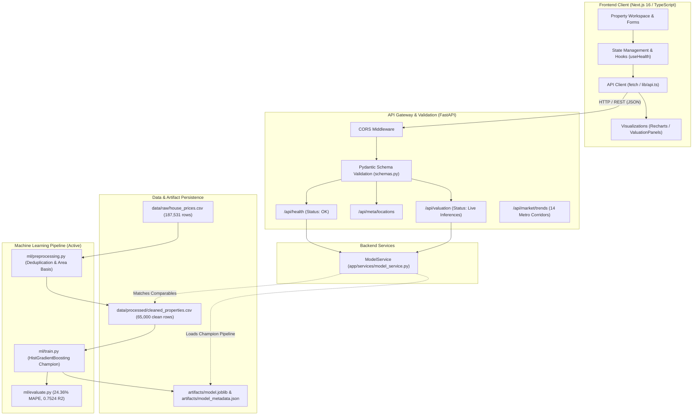
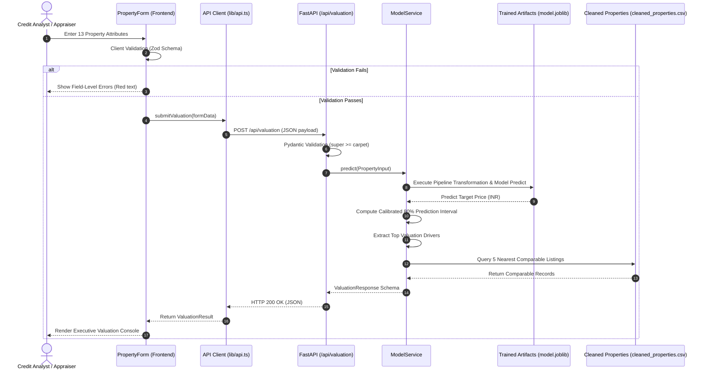

# System Architecture — NESTOR AI

> **Product**: NESTOR AI — Property Valuation Intelligence Platform  
> **Challenge**: Hero Housing Fintech Challenge  
> **Target Jurisdiction**: Indian Residential Real Estate  
> **Current Version**: `v0.2.0-beta` (Phase 1 & Phase 2 Complete)  
> **Last Verified**: 2026-11-10

---

## 1. System Overview

NESTOR AI is architected as a decoupled, multi-tier automated valuation and analytics platform. It bridges high-density statistical modeling with an institutional web experience tailored for housing finance institutions, credit risk teams, underwriters, and property appraisers.

The system comprises three primary subsystems:
1. **Frontend Presentation Layer**: A Next.js 16 App Router application engineered with TypeScript, Tailwind CSS v4, and Recharts.
2. **Backend Services Layer**: A high-throughput FastAPI application enforcing strict Pydantic validation, health monitoring, and modular routing.
3. **Machine Learning Intelligence Layer**: An offline-trained and online-served pipeline built with Scikit-learn, Pandas, and Joblib for valuation inference, uncertainty calibration, and feature attribution.

---

## 2. Overall System Architecture Diagram

---

## 3. Valuation Request Flow (Live Execution)

---

## 4. Local Development vs Future Production Deployment

### 4.1 Local Workstation (Current)
- Backend: Uvicorn on `http://localhost:8000`.
- Frontend: Next.js Turbopack on `http://localhost:3000`.
- ML Model: `artifacts/model.joblib` loaded on startup in under 150ms.

### 4.2 Target Production Architecture (Vercel + Cloud Run)
- Frontend deployed to Vercel Edge Network.
- Backend containerized in Docker with multi-stage build, running on Google Cloud Run or AWS App Runner.
- Cleaned dataset and model artifact bundled directly into the container or mounted via Cloud Storage.
